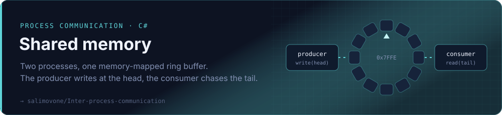
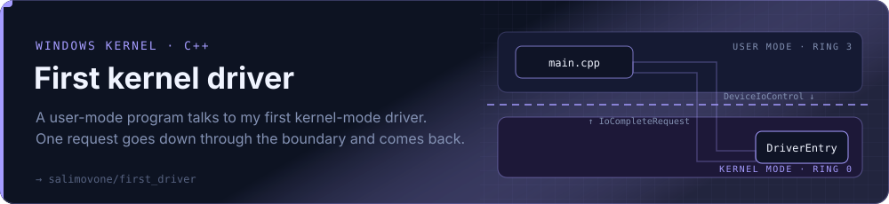
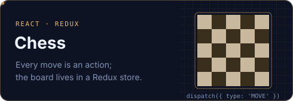
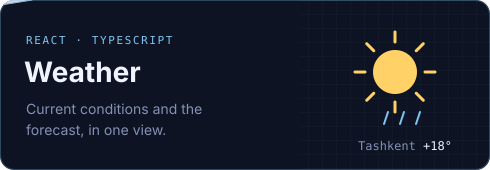

<a href="https://github.com/salimovone?tab=repositories">
  
</a>

<p align="center">
  <a href="https://www.linkedin.com/in/salimovone/"></a>
  <a href="https://medium.com/@salimovone"></a>
  <a href="https://leetcode.com/salimovone/"></a>
  <a href="https://www.hackerrank.com/pcprogrammer183"></a>
</p>

### `> whoami`

```cpp
// sardor.hpp — compiled in Tashkent, UTC+05:00
#pragma once

namespace salimovone {

struct Sardor final {
    static constexpr const char* role     = "systems developer";
    static constexpr const char* speaks[] = { "C++", "C#", "TypeScript" };
    static constexpr const char* lives_in = "the space between user mode and ring 0";

    // what I'm actually curious about
    void explore() const {
        how_processes_share_memory();    // → shared memory, ring buffers
        how_apps_talk_to_drivers();      // → DeviceIoControl, IRPs
        what_the_os_knows_about_ram();   // → performance counters
    }

    // and when the kernel needs a break
    void unwind() const { build_interfaces_with(React, Redux); }
};

} // namespace salimovone
```

## `~/systems`

<a href="https://github.com/salimovone/Inter-process-communication">
  
</a>
<sub>&nbsp;&nbsp;Follow one message from the <a href="https://github.com/salimovone/Inter-process-communication/blob/HEAD/Shared_memory_producer/RingBufferProducer.cs"><code>producer</code></a> to the <a href="https://github.com/salimovone/Inter-process-communication/blob/HEAD/Shared_memory_consumer/RingBufferConsumer.cs"><code>consumer</code></a> — both sides work with the same ring buffer.</sub>

<br /><br />

<a href="https://github.com/salimovone/first_driver">
  
</a>
<sub>&nbsp;&nbsp;Read the <a href="https://github.com/salimovone/first_driver/blob/HEAD/user_mode/src/main.cpp"><code>user-mode program</code></a> side by side with the <a href="https://github.com/salimovone/first_driver/blob/HEAD/kernel_mode/src/main.cpp"><code>driver entry point</code></a>.</sub>

<br /><br />

<a href="https://github.com/salimovone/ProcessResourceMonitor">
  
</a>
<sub>&nbsp;&nbsp;The whole trick fits in <a href="https://github.com/salimovone/ProcessResourceMonitor/blob/HEAD/ProcessResourceMonitor/Program.cs"><code>Program.cs</code></a>: one Windows performance counter, printed in megabytes.</sub>

## `~/stack`



## `~/side-quests`

<p>
  <a href="https://github.com/salimovone/chess"></a>
  <a href="https://github.com/salimovone/weather"></a>
</p>

<details>
  <summary><b>🛠 How this page is built</b></summary>
  <br />

  No third-party widgets, no stats cards that break overnight. Every banner here is a hand-rolled SVG animated with SMIL, generated by
  [`assets/generate.mjs`](./assets/generate.mjs). Change the text, run `node assets/generate.mjs assets`, commit.
</details>

<br />

 shutdown /s /t 0 /c &quot;thanks for reading — see you in ring 0&quot;" />

<p align="right"><sub><a href="https://www.instagram.com/sardor20.05/">instagram</a> · <a href="https://github.com/salimovone?tab=repositories">all repositories →</a></sub></p>
